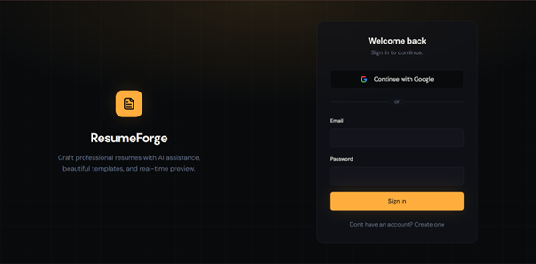
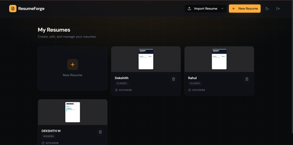
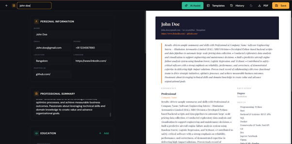
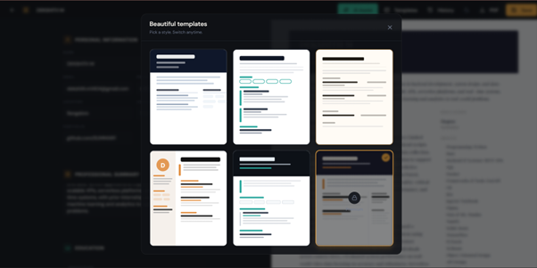
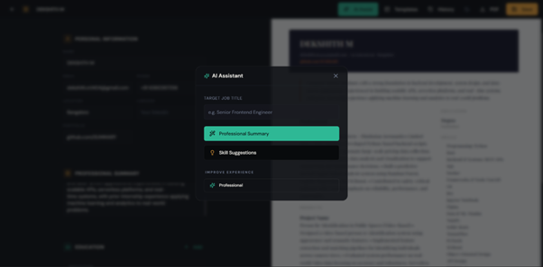

# ResumeForge – Professional AI Resume Builder


ResumeForge is a full-stack application designed to help professionals craft standout resumes with ease. Featuring AI-powered suggestions, real-time preview, and multiple professional templates.

## 📸 Screenshots

### Landing Page


### Dashboard


### Resume Editor


### Template Selection


### AI Assist


## 🚀 Features

- **AI-Powered Assistance**: Generate professional summaries, improve bullet points, and suggest skills.
- **Resume Import**: Smart parser for **PDF** and **DOCX** files to jumpstart your resume creation.
- **Split-Screen Editor**: Real-time side-by-side preview — see your changes instantly.
- **Professional Templates**: Switch between 6 curated styles (Classic, Modern, Tech, etc.) anytime.
- **Version History**: Automatic snapshot system to browse and restore previous saves.
- **Cloud Sync**: Securely store and manage multiple resumes with Supabase.

## 🏗 Architecture

```text
       React Frontend (Vite)
                ↓
       Express Backend API
                ↓
    Supabase (PostgreSQL + Auth)
```

## 🛠 Tech Stack

- **Frontend**: React 18, TypeScript, Tailwind CSS, shadcn/ui, Framer Motion.
- **Backend**: Node.js, Express.js (ESM), TypeScript.
- **Database & Auth**: Supabase (PostgreSQL), Google OAuth.
- **Parsing**: `pdf-parse` & `mammoth` for document processing.

## 📁 Project Structure

```text
├── frontend/             # React + Vite application
│   ├── src/
│   │   ├── components/   # Resume form, preview, and UI
│   │   ├── pages/        # Auth, Dashboard, and Editor
│   │   └── lib/          # API Client & configurations
├── backend/              # Express API Server
│   ├── routes/           # AI, Resumes, Versions, and Import
│   ├── services/         # Parsing & AI logic
│   └── index.ts          # Server entry point
└── db/                   # Database schema & migrations
```

## ⚙️ Setup Instructions

### 1. Prerequisites
- Node.js (v18+)
- Supabase Project

### 2. Environment Variables

**Frontend (`frontend/.env`):**
```env
VITE_SUPABASE_URL=your_project_url
VITE_SUPABASE_PUBLISHABLE_KEY=your_anon_key
VITE_API_URL=http://localhost:3001/api
```

**Backend (`backend/.env`):**
```env
PORT=3001
SUPABASE_URL=your_project_url
SUPABASE_SERVICE_ROLE_KEY=your_service_role_key
```

### 3. Installation & Running

```bash
# Clone and enter
git clone <repo-url>
cd resumeforge

# Terminal 1: Backend
cd backend && npm install && npm run dev

# Terminal 2: Frontend
cd frontend && npm install && npm run dev
```

## 💡 Assumptions Made

- **AI Generation**: Currently uses pattern-based NLP for speed; structured for easy LLM integration.
- **Data Persistence**: Resumes are stored as versioned JSON blobs for maximum template flexibility.
- **PDF Export**: Uses browser-print orchestration to ensure pixel-perfect fidelity of CSS layouts.

## 📄 License

MIT - Free for personal and commercial use.
